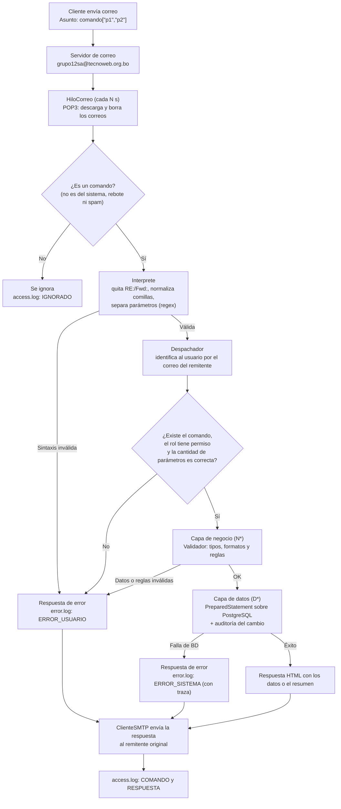
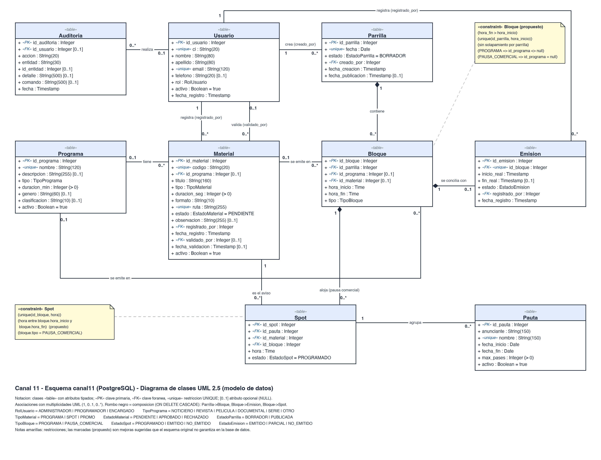

# Canal 11 — Sistema de Gestión de Programación y Contenidos

Tecnología Web (INF513) · Grupo 12 SA · Subsistema 12: Gestión de Programación y Contenidos (BMS, Tráfico).

Sistema operado por **correo electrónico**: el usuario escribe un comando en el **asunto**, el sistema lo lee por POP3,
consulta la base de datos PostgreSQL y responde por SMTP con un correo HTML (tablas).
Java puro, sin frameworks. POP3 y SMTP programados con `Socket`.

## Arquitectura (3 capas)

```
src/canal11/
  App.java          arranca el hilo de correo y procesa lo que llega: POP3 -> procesar -> SMTP
  config/           Config (lee config.properties)
  comunicacion/     HiloCorreo + OyenteCorreo (hilo que revisa el buzon), ClientePOP3, ClienteSMTP, Correo, MimeUtil   (sockets)
  presentacion/     Interprete (asunto), Despachador (catalogo y permisos), Ayuda (help), Html (plantilla)
  negocio/          N* (reglas de negocio y validaciones), Rol, Usuario
  datos/            D* (SQL con PreparedStatement), Conexion, Instalador
sql/                01_tablas.sql, 02_datos.sql, 03_mejoras.sql   (esquema canal11)
```

## Flujo del analizador de correos



Capas: `comunicacion` (POP3/SMTP con sockets) → `presentacion` (intérprete, despachador, HTML) →
`negocio` (validaciones y reglas) → `datos` (SQL). Cada capa solo llama a la siguiente.

## Base de datos (esquema `canal11` en PostgreSQL)



**Leyenda de enumeraciones** (la imagen es anterior al rol nuevo y a las mejoras de BD):

- `RolUsuario` = ADMINISTRADOR | PROGRAMADOR | ENCARGADO | **PRODUCCION**
- `TipoPrograma` = NOTICIERO | REVISTA | PELICULA | DOCUMENTAL | SERIE | OTRO · `TipoMaterial` = PROGRAMA | SPOT | PROMO
- `EstadoMaterial` = PENDIENTE | APROBADO | RECHAZADO · `EstadoParrilla` = BORRADOR | PUBLICADA
- `TipoBloque` = PROGRAMA | PAUSA_COMERCIAL · `EstadoSpot` = PROGRAMADO | EMITIDO | NO_EMITIDO · `EstadoEmision` = EMITIDO | PARCIAL | NO_EMITIDO

Las restricciones que la imagen marca como *(propuesto)* **ya están aplicadas en la BD** por [`sql/03_mejoras.sql`](sql/03_mejoras.sql): sin solapamiento por parrilla, `PROGRAMA ⇒ id_programa ≠ null`, `PAUSA_COMERCIAL ⇒ id_programa = null` y que el spot esté dentro del horario de su pausa. Además se reforzaron en la BD reglas que antes solo validaba el Java: rechazar un material exige observación, publicar una parrilla exige bloques con material aprobado, un spot respeta la vigencia y el máximo de pases de su pauta, y la auditoría es de solo inserción.

| Tabla | Para qué sirve | Claves y restricciones principales |
|---|---|---|
| `usuario` | Personas que usan el sistema; el rol (ADMINISTRADOR, PROGRAMADOR, ENCARGADO, PRODUCCION) define sus permisos | `ci` y `email` únicos (el email también sin distinguir mayúsculas: `ux_usuario_email_lower`); baja lógica (`activo`) |
| `programa` | Catálogo de programas (noticiero, película, serie...) | `nombre` único; duración > 0 |
| `material` | Video que se emite: programa, spot o promo; pasa por PENDIENTE → APROBADO/RECHAZADO | `codigo` y `ruta` únicos; duración > 0; `descripcion` opcional (texto de la nota); `ck_material_rechazo` (RECHAZADO exige observación) y `ck_material_validado` (si no es PENDIENTE exige `validado_por`) |
| `parrilla` | Programación de un día (BORRADOR o PUBLICADA) | una por `fecha`; trigger `fn_validar_publicacion`: al pasar a PUBLICADA debe tener bloques y cada bloque PROGRAMA un material activo y APROBADO |
| `bloque` | Franja horaria de la parrilla: programa o pausa comercial | `hora_fin > hora_inicio`; `ck_bloque_tipo`; sin solapamientos (`ex_bloque_sin_solape`, también validado en `NParrilla`) |
| `pauta` | Contrato publicitario de un anunciante con vigencia y máximo de pases | `nombre` único; `fecha_fin >= fecha_inicio` |
| `spot` | Aviso ubicado en una pausa comercial | un spot por (`bloque`, `hora`); trigger `fn_validar_spot`: bloque PAUSA_COMERCIAL, hora dentro de la pausa, material SPOT aprobado; trigger `fn_validar_spot_pauta`: la fecha dentro de la vigencia de la pauta y sin superar `max_pases` (los NO_EMITIDO no cuentan) |
| `emision` | Lo realmente emitido de cada bloque (EMITIDO, PARCIAL, NO_EMITIDO) | una por bloque; `ck_emision_fin` (`fin_real` posterior a `inicio_real`) |
| `escaleta` | Orden de las notas de un bloque de noticiero o revista (lead 1, lead 2...) | `UNIQUE (id_bloque, orden)` diferible (se reordena con un solo UPDATE) y `UNIQUE (id_bloque, id_material)`; se borra con su bloque |
| `aviso_enviado` | Avisos automáticos ya enviados (recordatorios y alertas) para no repetirlos | PK (`tipo`, `clave`) |
| `auditoria` | Historial de cada cambio: quién, qué, cuándo y con qué comando | solo inserción: el trigger `fn_auditoria_inmutable` rechaza UPDATE, DELETE y TRUNCATE (no frena a quien administre la BD; para eso hay que quitar esos permisos al rol de la aplicación); índice por (`entidad`, `id_entidad`); la FK a `usuario` **no** lleva `ON DELETE SET NULL`: los usuarios solo se dan de baja lógica y SET NULL borraría en silencio quién hizo cada cambio |

Scripts: [`sql/01_tablas.sql`](sql/01_tablas.sql) (tablas), `02_datos.sql` (administrador inicial) y [`sql/03_mejoras.sql`](sql/03_mejoras.sql) (restricciones, triggers, índices, `material.descripcion` y rol PRODUCCION). `--instalar` los ejecuta en orden y es repetible; antes de `03` revisa que los datos existentes no violen las restricciones (solapes, tipo de bloque, correos repetidos, materiales rechazados sin observación o validados sin responsable, emisiones con fin anterior al inicio). Si el servidor no deja crear la extensión `btree_gist`, avisa y sigue (el solape queda validado solo en `NParrilla`).

**Plazo de revisión:** `material.pendiente_desde`, `ultimo_aviso` y `avisos` (0-2) llevan el recordatorio y el escalamiento (`ck_material_avisos`).

**Roles y áreas del canal:** Prensa → `ENCARGADO` · Programación → `PROGRAMADOR` (arma la parrilla, pautas y spots, y registra sus propios materiales con `insMat`/`modMat`/`eliMat`; no los aprueba) · Producción → `PRODUCCION` (consulta todo y registra la emisión real con `insEmi`) · dirección/sistemas → `ADMINISTRADOR`.

## Avisos automáticos y reglas del flujo

El sistema ya no solo contesta cuando le preguntan: **avisa solo**. Es lo que el levantamiento pedía para dejar de depender de WhatsApp
(el orden iba por WhatsApp porque es inmediato; ahora el correo también lo es). Los avisos se envían con el servidor corriendo
(no en `--probar` ni `--lote`) y cada uno queda en la auditoría o en `access.log`.

| Aviso | Cuándo | A quién |
|---|---|---|
| Parrilla publicada | al ejecutar `pubPar` | Producción y Prensa (orden del día, con la escaleta del noticiero) |
| Cambio en la parrilla | `camBlo` sobre una parrilla publicada | Producción y Prensa |
| Cambio en el orden del noticiero | `insLea`/`modLea`/`eliLea` con la parrilla publicada | Producción y Programación |
| Material aprobado o rechazado | al ejecutar `valMat` | quien registró el material |
| **Recordatorio** de revisión | material PENDIENTE más de `revision.minutos_aviso` | `ENCARGADO` (Prensa) |
| **Escalamiento** | sigue PENDIENTE pasados `revision.minutos_escalar` | `ADMINISTRADOR` |
| Material rechazado sin corregir | `revision.correccion_minutos` después del rechazo | quien lo registró |
| Parrilla en riesgo | `alerta.parrilla_horas` antes del día: sin crear, en borrador o con materiales sin aprobar | Programación (y Prensa si hay pendientes); a `alerta.parrilla_urgente_horas` también al administrador |
| Emisión sin registrar | un bloque terminó hace más de `alerta.emision_minutos` sin `insEmi` | Producción |

Los recordatorios de revisión (y de rechazos) solo salen entre `revision.hora_desde` y `revision.hora_hasta`. Nunca se aprueba ni se rechaza por
tiempo: solo se avisa. Los avisos automáticos se marcan en `aviso_enviado` para no repetirse. Para una demostración en vivo, poner
`revision.minutos_aviso=2`, `revision.minutos_escalar=4` y `revision.intervalo=10` en `config.properties`.

**Reglas nuevas del flujo**

- **Escaleta del noticiero** (`lisLea`, `insLea`, `modLea`, `eliLea`): el orden de las notas ("lead 1 / video 1") dentro de un bloque de un programa NOTICIERO o REVISTA.
  `lisLea` da la hora estimada de entrada de cada nota. Se cambia hasta que el bloque empieza, incluso con la parrilla publicada. Un bloque con escaleta no necesita material propio.
- **`camBlo`**: cambia el material de un bloque (aun con la parrilla publicada) mientras no haya empezado; el material debe estar APROBADO.
- **Quien registra no valida:** `valMat` rechaza que el mismo usuario apruebe lo que registró.
- **Fechas contra hoy** (`app.zona`, por defecto America/La_Paz): no se crean ni publican parrillas pasadas y `insEmi` solo acepta lo que ya empezó. Para pruebas, `app.ahora` fija la hora y en `--lote` la línea `@ahora AAAA-MM-DDTHH:MM`.
- **Canal 24/7:** `hora_fin` acepta `24:00` (se guarda como 23:59:59) y `pubPar` avisa los huecos al inicio y al final del día y la cobertura. Una película que cruza la medianoche se parte en dos parrillas.
- **Materiales:** la extensión de la `ruta` debe coincidir con el `formato`, y `insMat`/`modMat` advierten un posible duplicado (mismo título, tipo y duración). `lisMat["VENCIDO"]` lista los pendientes que ya recibieron aviso.

## Seguridad y registro

- **Inyección SQL:** toda consulta usa `PreparedStatement`; ningún dato del correo se concatena al SQL.
- **Validación:** `Validador` revisa tipos, formatos, rangos y reglas de negocio **antes** de tocar la base y devuelve todos los errores juntos.
- **Parsing robusto:** tolera espacios extra, comillas tipográficas (celulares, Word), `RE:`/`Fwd:`, UTF-8, comas dentro de comillas y comillas dobles escapadas dentro de un parámetro (`\"` o `""`: `insPro["Dijo \"hola\"","x"]` → `Dijo "hola"`). Otras barras invertidas se conservan (rutas `D:\videos\nota.mp4`).
- **Coherencia del bloque:** `insBlo` rechaza un SPOT en un bloque PROGRAMA, un material de otro programa o que dure más que el bloque; `modMat` no deja cambiar ruta, duración ni tipo de un material que está en una parrilla publicada.
- **Permisos por rol:** el rol del remitente decide qué comandos puede usar.
- **Logs locales** (carpeta `logs/`, creada sola; no se sube a git):
  - `logs/access.log`: cada correo recibido (`CORREO`), ignorado (`IGNORADO`), comando ejecutado con resultado y tiempo (`COMANDO`) y respuesta enviada (`RESPUESTA`).
  - `logs/error.log`: errores de uso (`ERROR_USUARIO`: sintaxis, permisos, reglas) y fallos del sistema (`ERROR_SISTEMA`: base de datos, POP3, SMTP) con la traza.
  - Formato: `2026-11-20 10:15:30 | COMANDO | de=ana@gmail.com | asunto=lisPro["*"] | resultado=OK | 42 ms`
- **Auditoría en base de datos:** cada alta, cambio o baja queda en `auditoria`; el administrador la consulta con `lisAud`.

## Puesta en marcha

Requisitos: Java 17 o superior y el driver incluido en `lib/`.

El perfil (`local` o `real`) es **obligatorio**: así nunca se toca la base o el correo del curso por error. Compilar es igual para los dos.

| | `local` | `real` |
|---|---|---|
| Configuración | `config.local.properties` (se crea sola desde `config.local.properties.example`) | `config.properties` (copiar `config.properties.example` y completar las contraseñas) |
| Base de datos | PostgreSQL local, base `canal11_local` | `db_grupo12sa` del curso |
| Correo | Mailpit en Docker (POP3 55110, SMTP 55025, web http://localhost:58025) | servidor del curso |

```bash
./scripts/compilar.sh                       # (Windows: scripts\compilar.bat) igual para local y real
./scripts/ejecutar.sh local --instalar      # crea las tablas (la primera vez lo hace solo)
./scripts/ejecutar.sh local                 # todo local: prepara base y Mailpit si hace falta y arranca el sistema
./scripts/ejecutar.sh real --instalar       # lo mismo contra el servidor del curso
./scripts/ejecutar.sh real                  # revisa grupo12sa@tecnoweb.org.bo cada 10 s y responde
```

**Datos de demostración:** `./scripts/ejecutar.sh local --poblar` **borra la base local** y la recarga con la programación de Canal 11 basada en la grilla real
del viernes 20-11-2026 (programas, horarios y duraciones reales; 4 días con parrillas, escaletas, spots y emisiones; las fechas son relativas a hoy,
así que se repite el día de la defensa). Solo se permite en base local: sobre la del curso se niega. El guion está en [docs/GUION_DEFENSA.md](docs/GUION_DEFENSA.md)
y los comandos se mandan con `./pruebas/cmd.sh ana 'lisLea["{HOY}","12:30"]'`. Los datos se generan con `scripts/generar_04_demo.py`.

Con `local` se manda un comando como si fuera un correo y las respuestas y avisos se ven en http://localhost:58025
(en local los correos no se borran al leerlos: `pop3.borrar=false`):

```bash
python3 scripts/enviar_local.py ana.rojas@gmail.com 'lisMat["PENDIENTE"]'
```

Todos los ejemplos de abajo usan `scripts\ejecutar.bat <perfil>`; en Linux/macOS es `./scripts/ejecutar.sh <perfil>` con los mismos argumentos.

Si el servidor del curso no es alcanzable directamente, se puede usar un túnel SSH y apuntar `config.properties` a `localhost`
(puertos del túnel en `pop3.puerto`, `smtp.puerto` y `db.puerto`).

Herramientas de prueba:

| Comando | Para qué |
|---|---|
| `scripts\ejecutar.bat local --probar "help" larzekaobnc@gmail.com` | Procesa un asunto sin correo; guarda la respuesta en `salida/respuesta.html` |
| `scripts\ejecutar.bat local --lote pruebas\cu1.txt` | Ejecuta una batería de pruebas; respuestas en `salida/01.html`, `02.html`... |
| `scripts\ejecutar.bat real --buzon` | Lista los correos del buzón sin borrarlos |
| `scripts\ejecutar.bat real --enviar-prueba correo@destino.com` | Envía la ayuda a un correo (prueba del SMTP) |

> El servidor SMTP del curso solo reenvía a correos externos (Gmail) desde la red de la facultad.

Contra la base del curso cada comando tarda varios segundos; en `local` toda la batería corre en unos 7 s:

```bash
for n in 1 2 4 5 3 6 7 8 9; do ./scripts/ejecutar.sh local --lote pruebas/cu$n.txt; done
```

## Uso

Formato del asunto: `comando["parametro1","parametro2",...]`

1. `help` → casos de uso disponibles para su rol.
2. `help["3"]` → comandos del CU3 con parámetros y ejemplo.
3. Copiar el ejemplo, cambiar los valores y enviarlo.

El usuario se identifica por el correo del remitente (Gmail, Outlook/Hotmail, Yahoo, UAGRM o cualquier otro);
su rol define qué comandos puede usar. Si responde o reenvía un correo, los prefijos `RE:` / `Fwd:` se ignoran.
Si escribe mal un comando, la respuesta sugiere el correcto.

## Comandos por caso de uso

**Para continuar el desarrollo, leer [docs/GUIA_DESARROLLO.md](docs/GUIA_DESARROLLO.md).**

Acciones: `lis` listar · `mos` mostrar · `ins` insertar · `mod` modificar · `eli` eliminar (baja lógica).
Sin IDs: cada registro se referencia por un dato conocido (usuario por CI o email, programa por nombre,
material por código, parrilla por fecha, bloque por fecha + hora, pauta por nombre).

| CU | Comandos |
|---|---|
| CU1 Gestión de Usuarios | `lisUsu` `mosUsu` `insUsu` `modUsu` `eliUsu` `actUsu` |
| CU2 Catálogo de Programas | `lisPro` `mosPro` `insPro` `modPro` `eliPro` |
| CU3 Confeccionar y Controlar la Parrilla | `lisPar` `mosPar` `insPar` `eliPar` `insBlo` `eliBlo` `camBlo` `pubPar` `lisLea` `insLea` `modLea` `eliLea` |
| CU4 Materiales de Video | `lisMat` `mosMat` `insMat` `modMat` `eliMat` |
| CU5 Validar Estado de Emisión | `valMat` `estPar` |
| CU6 Pauta Publicitaria e Insertar Spots | `lisPau` `mosPau` `insPau` `eliPau` `insSpo` `eliSpo` |
| CU7 Conciliar Emisión Real, Registrar Auditoría | `insEmi` `conPar` `lisAud` |
| CU8 Reportes y Estadísticas | `repPro` `repMat` `repPau` `repCum` |

## Avance

| Fase | Contenido | Estado |
|---|---|---|
| 0 | Infraestructura: sockets POP3/SMTP, hilo de verificación de correo, intérprete, plantilla HTML, `help`, catálogo de comandos, tablas | ✅ |
| 1 | CU1 Usuarios (con reactivación) + auditoría + validaciones + correos de cualquier proveedor + `RE:`/`Fwd:` + sugerencia de comando | ✅ |
| 2 | CU2 Programas, CU4 Materiales | ✅ |
| 3 | CU3 Parrilla | ✅ |
| 4 | CU5 Validación | ✅ |
| 5 | CU6 Pauta y spots | ✅ |
| 6 | CU7 Emisión y conciliación | ✅ |
| 7 | CU8 Reportes | ✅ |
| 8 | Logs `access.log` / `error.log` | ✅ |
| 9 | Endurecer la BD (`03_mejoras.sql`) + rol `PRODUCCION` | ✅ Probado con `pruebas/bd_restricciones.sql` (23 comprobaciones) |
| 10 | Reglas de negocio también en la BD (material, publicación, pauta, emisión) + auditoría inmutable + `material.descripcion` | ✅ Probado con `pruebas/bd_restricciones.sql` |

Las baterías `pruebas/cu1.txt` a `cu8.txt` se corrieron completas contra una base PostgreSQL local con los resultados esperados.
Pendiente: la prueba de extremo a extremo con el correo real del servidor del curso (POP3/SMTP).

> Las baterías `--lote` crean datos de prueba (fechas de 2030 y 2031): correrlas solo contra una base local o de pruebas.
