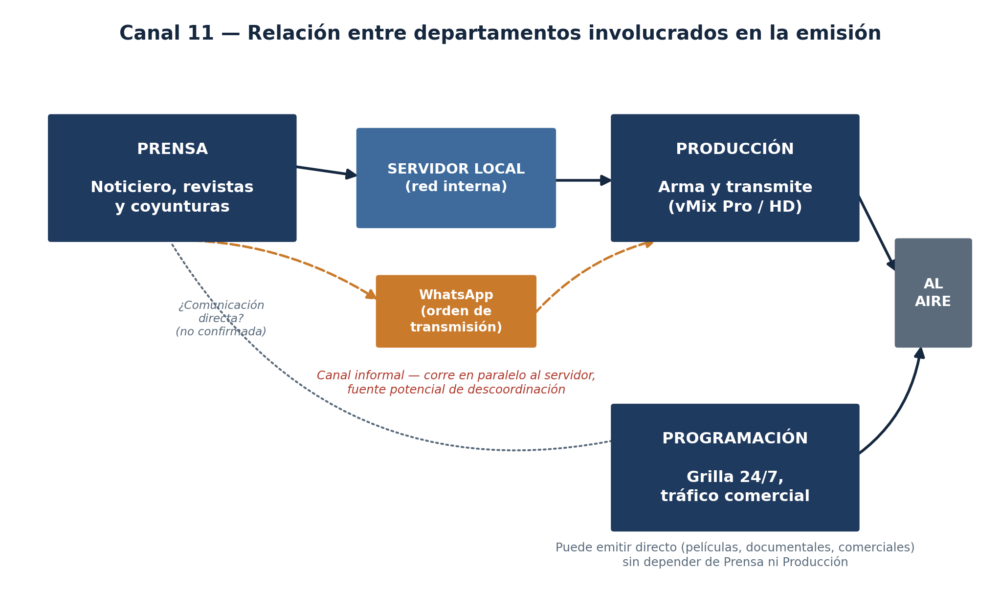
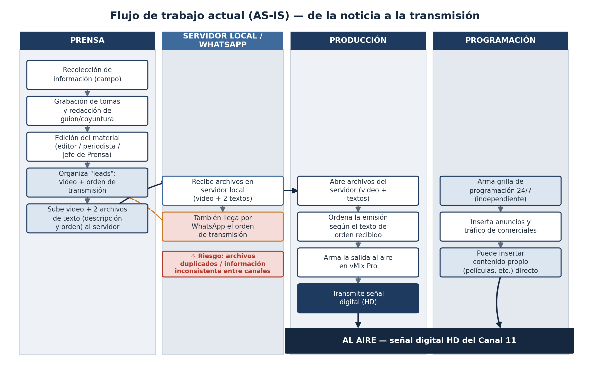
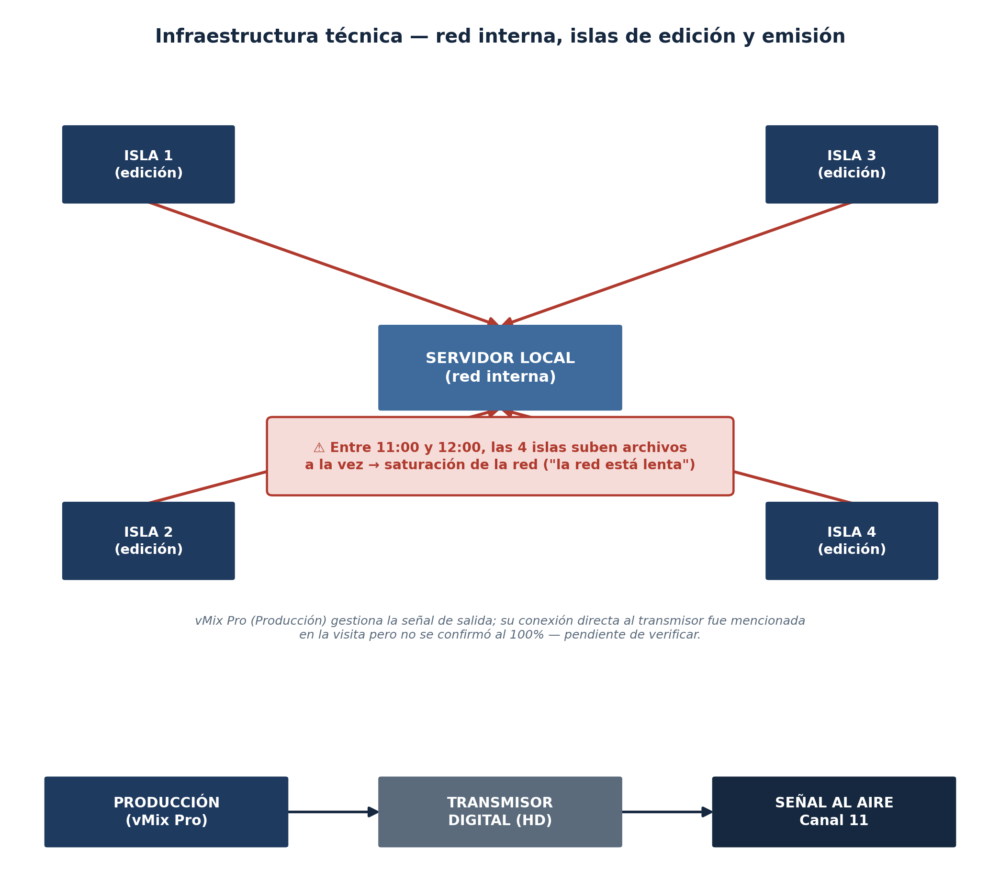

# Canal 11 TVU — Levantamiento de información unificado

**Qué es este documento.** Reúne en un solo lugar todo lo que se levantó sobre Canal 11: lo que se dijo en la entrevista, lo que se vio en la visita técnica, los datos institucionales, el análisis de los problemas y cómo cada hallazgo terminó en una decisión del sistema vía correo.

Materia: Tecnología Web (INF513-SA) · Proyecto 1 · Grupo 12 · Gestión II/2026 · Santa Cruz de la Sierra, Bolivia.

**Fuentes que se unifican aquí**

| Fuente | Qué aporta |
|---|---|
| Entrevista con el director del canal | Función de cada departamento, flujo documental y problemas percibidos |
| Visita técnica en sitio (audio transcrito) | Servidor local, islas de edición, red, WhatsApp, vMix Pro |
| `Canal11_Levantamiento_Informacion.md` (septiembre 2026) | Informe AS-IS original y sus 3 diagramas |
| `Canal11_Documentacion_P1.docx` | Datos institucionales, requisitos, casos de uso y resultados |
| Código y `docs/` del repositorio | Cómo se resolvió cada problema (README, `GUIA_DESARROLLO.md`, SQL) |

**Convención de confianza.** Cada afirmación lleva una marca de qué tan firme es:

- ✅ **Observado / dicho**: salió directamente de la entrevista o de la visita.
- 🔎 **Interpretación del equipo**: conclusión nuestra a partir de lo observado.
- ⚠️ **Sin confirmar**: quedó dudoso en la recolección; no basar decisiones de diseño en ello.
- 📚 **Fuente externa**: dato institucional público (UAGRM, Wikipedia), no dicho por el canal.

---

## Índice

1. [Resumen ejecutivo](#1-resumen-ejecutivo)
2. [Metodología de recolección](#2-metodología-de-recolección)
3. [La organización: datos institucionales](#3-la-organización-datos-institucionales)
4. [Estructura del flujo de contenidos](#4-estructura-del-flujo-de-contenidos)
5. [Descripción detallada por departamento](#5-descripción-detallada-por-departamento)
6. [Flujo actual AS-IS, paso a paso](#6-flujo-actual-as-is-paso-a-paso)
7. [Infraestructura técnica observada](#7-infraestructura-técnica-observada)
8. [Problemas identificados y análisis de causas](#8-problemas-identificados-y-análisis-de-causas)
9. [Datos que circulan entre áreas (inventario de información)](#9-datos-que-circulan-entre-áreas-inventario-de-información)
10. [Puntos sin confirmar y supuestos](#10-puntos-sin-confirmar-y-supuestos)
11. [Del levantamiento a los requisitos](#11-del-levantamiento-a-los-requisitos)
12. [Trazabilidad: problema → decisión de diseño → implementación](#12-trazabilidad-problema--decisión-de-diseño--implementación)
13. [Situación deseada (TO-BE)](#13-situación-deseada-to-be)
14. [Qué NO resuelve el sistema](#14-qué-no-resuelve-el-sistema)
15. [Preguntas para validar con el canal](#15-preguntas-para-validar-con-el-canal)
16. [Glosario](#16-glosario)

---

## 1. Resumen ejecutivo

Canal 11 TVU produce y emite su contenido con **tres departamentos**: Prensa, Producción y Programación. El director identificó como **principal problema la comunicación deficiente entre ellos**.

Lo esencial del diagnóstico:

1. **Prensa** graba, redacta y edita el noticiero y las revistas. Entrega por red interna un **video + 2 archivos de texto** (descripción y orden de transmisión) a un **servidor local**. ✅
2. **Producción** lee esos archivos, ordena la emisión y la transmite con **vMix Pro** en **señal digital HD**. ✅
3. **Programación** arma una grilla **24/7** con publicidad y contenido propio, **de forma independiente** de Prensa y Producción. ✅
4. El **orden de transmisión viaja por dos canales**: el servidor y **WhatsApp**. Eso crea una **doble fuente de verdad**. ✅
5. Hay **archivos repetidos**, una **red saturada de 11:00 a 12:00** (4 islas suben a la vez) y **no está claro si Programación y Prensa se comunican**. ✅ / ⚠️

El proyecto responde al problema de coordinación con un sistema operado por **correo electrónico**: el usuario escribe un comando en el asunto, el servidor lo lee por POP3, opera sobre PostgreSQL y responde por SMTP con un HTML. La **parrilla publicada** pasa a ser la única fuente del orden de transmisión.

> **Alcance honesto.** El sistema ataca los problemas 1, 2, 3 y 5 (coordinación, duplicados, doble fuente, trazabilidad). **No** resuelve la saturación de la red (problema 4): es de infraestructura. Ver [sección 14](#14-qué-no-resuelve-el-sistema).

---

## 2. Metodología de recolección

### 2.1 Técnicas usadas

| Técnica | Cómo se hizo | Resultado |
|---|---|---|
| **Entrevista abierta** | Conversación con el director del canal; explicó en sus palabras la función de cada área, el flujo y los problemas | Estructura organizacional, flujo documental, prioridad de problemas |
| **Observación directa (visita técnica)** | Recorrido por edición y transmisión, grabado en audio; se vio el servidor, el software de emisión y la red, y se habló con personal técnico | Infraestructura, saturación de red, uso de WhatsApp, vMix Pro |

### 2.2 Tratamiento de los datos

- El audio de la visita se grabó frente a una pantalla con noticias al aire. El contenido informativo de fondo (notas que se estaban emitiendo) se **identificó y descartó** por no ser relevante.
- Ambas fuentes se **transcribieron y depuraron a mano**.
- Las citas textuales ("la red está lenta", "creo que no") vienen de esas transcripciones y se conservan entre comillas para separar **lo observado** de **lo interpretado**.
- Lo que no se pudo confirmar al 100 % se marca como pendiente (sección 10) en lugar de asumirse.

### 2.3 Límites del levantamiento

- Una sola entrevista (el director); no se entrevistó por separado al jefe de Prensa, a Producción ni a Programación. 🔎
- Una sola visita técnica; la saturación de 11:00–12:00 se conoce por lo que dijo el personal, **sin medición** de tráfico. 🔎
- No se levantaron volúmenes (cuántas notas por día, tamaño de archivos, cuántos spots por pausa). Esos datos no existen en las fuentes.

---

## 3. La organización: datos institucionales

> Esta sección sale de fuentes públicas (UAGRM y Wikipedia), no de la entrevista. 📚 Conviene confirmar o reemplazar con el texto oficial que entregue la dirección.

| Dato | Valor |
|---|---|
| Nombre | **Canal 11 TVU** (Televisión Universitaria), de la UAGRM |
| Eslogan | "El primer canal de Santa Cruz" |
| Frecuencia | Canal 11 VHF; equivalente digital 11.1 |
| Sede | Campus de la UAGRM, Santa Cruz de la Sierra (dirección exacta **pendiente**) |
| Carácter | Canal público, educativo y cultural de origen universitario |
| Programación | Abierta, **24 h × 7 días**: noticiero y revistas (producción propia), películas, documentales, publicidad |

**Historia resumida** 📚

| Fecha | Hito |
|---|---|
| 1 mar 1973 | Se lanza el Centro de Televisión de la UAGRM con emisiones experimentales 3 días por semana, desde un transmisor casero en el canal 8; primer canal en emitir en Santa Cruz |
| Fines de 1978 | Pasa a transmitir a color y al canal 11, su frecuencia actual |
| 1986 | Incorpora un transmisor de 10 kW (donación japonesa) |
| Ago 2023 | Convenio UAGRM–Cooperativa Rural de Electrificación para digitalizar la señal |
| Dic 2023 | Recibe un transmisor digital desde Alemania; meta: servicio HD desde el 1 ene 2024 |
| 2025 | Celebra 52 años |

**Misión y visión.** No se encontró un texto institucional propio publicado. Lo que declara la UAGRM: servir a Santa Cruz y Bolivia con conocimiento, cultura y educación, articulando Universidad y sociedad (misión); y consolidarse como el mejor canal de la región con innovación, calidad y formación de talentos (visión). 📚 **Pendiente de confirmar con la dirección.**

**Pendientes de identidad:** logo oficial y captura del mapa con la dirección exacta.

---

## 4. Estructura del flujo de contenidos

Tres departamentos con responsabilidades diferenciadas, más un canal informal (WhatsApp) detectado en la visita.



*Figura 1. Relación entre departamentos.*

| Departamento | Función principal | Entrada → Salida | Observaciones |
|---|---|---|---|
| **Prensa** | Recolectar información, grabar, redactar y editar las notas del noticiero y revistas | Hechos noticiosos (campo) → video + 2 archivos de texto (descripción y orden) | Solo cubre el noticiero; no otros contenidos |
| **Producción** | Tomar el material de Prensa y armar/transmitir la emisión | Archivos del servidor local → señal digital HD al aire | Usa vMix Pro |
| **Programación** | Armar la grilla 24/7 con publicidad y contenido propio | No recibe nada de Prensa/Producción → contenido directo al aire | Puede emitir películas, documentales o comerciales sin depender de los otros dos |

**Lectura clave** 🔎: Prensa → Producción es una **cadena directa y dependiente**. Programación es un **carril paralelo** que desemboca en el mismo punto (el aire) pero sin coordinación formal con los otros dos. Ahí nace el riesgo de descoordinación.

---

## 5. Descripción detallada por departamento

### 5.1 Prensa

**Alcance** ✅: exclusivamente el noticiero de Canal 11 (noticias y revistas).

**Roles** ✅: periodistas, editores de video y el **jefe de Prensa**, que aprueba el material antes de entregarlo.

**Actividades** ✅

1. Recolección de información y trabajo de campo (entrevistas, cobertura).
2. Grabación de tomas y videos en el lugar.
3. Redacción de guiones y **coyunturas** (contextualización de la noticia).
4. Edición del material, con revisión de editores y periodistas.
5. Organización de **leads**: a cada nota se le asigna un orden (p. ej. "lead 1 / video 1").

**Producto entregado** ✅: tras la aprobación, Prensa sube a su servidor local, por la red interna:

| Archivo | Contenido |
|---|---|
| Video terminado | La nota editada |
| Texto de **descripción** | De qué trata la nota |
| Texto de **orden de transmisión** | Secuencia en que las notas deben salir al aire |

Además, el texto del orden **también se envía por WhatsApp**, en paralelo al servidor.

### 5.2 Producción

**Rol** ✅: recibe los archivos de Prensa y es responsable de armar la emisión y ponerla al aire.

**Actividades** ✅

1. Abrir y revisar los archivos del servidor (video + textos).
2. Ordenar la emisión según el texto de orden de transmisión.
3. Armar la salida al aire con **vMix Pro**.
4. Transmitir en **señal digital HD** (el canal migró de analógica a un transmisor HD).

**Dependencia** ✅: todo lo que Producción transmite del noticiero proviene de lo que Prensa sube al servidor.

### 5.3 Programación

**Rol** ✅: arma la grilla que se transmite 24/7, incluida la publicidad y el tráfico comercial.

**Actividades** ✅

1. Definir la grilla general (qué se transmite y por cuánto tiempo).
2. Insertar anuncios y tráfico de comerciales.
3. Insertar contenido propio de forma directa (películas, documentales, comerciales) sin pasar por Prensa ni Producción.

**Independencia** ✅: no depende del material de Prensa.

**Duda del director** ⚠️: no quedó confirmado si hay comunicación directa y sistemática con Prensa. Respuesta textual: *"creo que no"*.

---

## 6. Flujo actual AS-IS, paso a paso



*Figura 2. Flujo AS-IS: de la noticia a la transmisión.*

| # | Quién | Qué ocurre | Canal |
|---|---|---|---|
| 1 | Prensa | Recolecta información en campo | — |
| 2 | Prensa | Graba tomas y redacta guion/coyuntura | — |
| 3 | Prensa | Edita (editor, periodista, jefe de Prensa aprueba) | — |
| 4 | Prensa | Organiza los *leads* (video + orden) | — |
| 5 | Prensa | Sube video + 2 textos al servidor local | Red interna |
| 5b | Prensa | **Envía también el orden por WhatsApp** | Informal |
| 6 | Producción | Abre los archivos del servidor | Red interna |
| 7 | Producción | Ordena la emisión según el texto recibido | — |
| 8 | Producción | Arma la salida en vMix Pro | — |
| 9 | Producción | Transmite en señal digital HD → **al aire** | Transmisor |
| P1 | Programación | Arma la grilla 24/7 (independiente) | — |
| P2 | Programación | Inserta anuncios y tráfico comercial | — |
| P3 | Programación | Puede insertar contenido propio directo → **al aire** | — |

**Punto crítico** 🔎: los pasos 5 y 5b entregan el mismo dato (el orden) por dos vías. Si no coinciden o no se actualizan a la vez, Producción puede leer un orden o una versión distinta de la que Prensa quiso enviar.

**Lo que el flujo actual no tiene** 🔎:

- Ninguna **validación** de que un material esté aprobado antes de emitirlo (la aprobación del jefe de Prensa es interna y no queda registrada).
- Ningún **registro** de qué se programó vs. qué se emitió.
- Ninguna **trazabilidad** de quién cambió qué y cuándo.
- Ninguna **fuente única** del orden de transmisión.

---

## 7. Infraestructura técnica observada



*Figura 3. Red interna: 4 islas, servidor local y cadena de emisión (Producción → Transmisor → Al aire).*

| Elemento | Detalle | Confianza |
|---|---|---|
| **Servidor local** | Compartido por Prensa y Producción; accesible por red interna propia. Es el canal formal de entrega | ✅ |
| **Red interna** | Propia del canal; da servicio al servidor y a las islas | ✅ |
| **Islas de edición** | **4** estaciones de edición de video conectadas a la misma red | ✅ |
| **Saturación** | Entre **11:00 y 12:00** las 4 islas suben archivos a la vez; la red se percibe lenta (*"la red está lenta"*) | ✅ (sin medición) |
| **WhatsApp** | Canal informal paralelo para enviar el orden de transmisión | ✅ |
| **vMix Pro** | Software de emisión con **licencia comprada**; el personal lo describió como "uno de los mejores programas" | ✅ |
| **Conexión vMix ↔ transmisor** | Se mencionó que está conectado, pero no quedó claro en el audio | ⚠️ |
| **Transmisor** | Digital HD (migración desde analógica) | ✅ |

> **Hallazgo técnico** 🔎: la saturación de 11:00–12:00 **no es un problema de comunicación entre personas**, es un **cuello de botella de infraestructura**. Se suma, y probablemente agrava, el problema de coordinación: retrasa los archivos que Producción necesita leer.

**Equipamiento (fuera de alcance, solo contexto):** las máquinas de edición de Prensa no son ideales para video y el departamento no tiene cámaras propias adecuadas. Quien condujo el levantamiento indicó expresamente que **no forma parte del análisis**.

---

## 8. Problemas identificados y análisis de causas

### 8.1 Tabla consolidada (en orden de relevancia según el director)

| # | Problema | Evidencia | Área afectada | Impacto potencial |
|---|---|---|---|---|
| 1 | **Comunicación deficiente entre departamentos** | El director lo señaló como el principal problema | Prensa ↔ Producción ↔ Programación | Retrasos, confusión operativa, pérdida de trazabilidad |
| 2 | **Archivos repetidos / duplicados** | Ejemplo concreto dado por el director al describir el problema 1 | Servidor local / Producción | No se sabe qué versión transmitir; reproceso |
| 3 | **Canal informal (WhatsApp) paralelo al formal** | Visita técnica: el orden va al servidor y por WhatsApp | Prensa → Producción | Doble fuente de verdad; orden inconsistente |
| 4 | **Saturación de la red interna (11:00–12:00)** | Personal técnico: 4 islas suben a la vez | Red interna / Servidor | Lentitud; archivos que llegan tarde a Producción |
| 5 | **Relación Programación–Prensa no confirmada** | Director: *"creo que no"* | Programación ↔ Prensa | Grilla desalineada del contenido noticioso |

### 8.2 Análisis de causas 🔎

```
Problema 1  Comunicación deficiente
 ├─ Causa: no existe un sistema que centralice el orden de transmisión
 ├─ Causa: la coordinación se apoya en archivos sueltos y mensajería informal
 └─ Efecto: → Problemas 2, 3 y 5

Problema 2  Archivos duplicados
 ├─ Causa: no hay identificador único por material (nada impide subir el mismo video dos veces)
 ├─ Causa: no hay registro de versiones ni de estado (¿cuál es el bueno?)
 └─ Agravante: Problema 3 (el orden llega por dos vías)

Problema 3  Doble fuente de verdad
 ├─ Causa: el servidor no se considera suficiente o es lento (Problema 4)
 └─ Posible causa: WhatsApp es inmediato y no depende de la red interna

Problema 4  Red saturada
 └─ Causa: 4 islas suben simultáneamente en la misma franja (infraestructura)

Problema 5  Programación aislada
 └─ Causa: no existe un punto común donde ambas vean la programación del día
```

**Relaciones entre problemas** 🔎

- **4 → 3**: si la red está lenta, es plausible que el equipo recurra a WhatsApp para asegurar el orden. *Es una hipótesis; no se verificó con el personal.*
- **3 → 2**: dos fuentes del orden favorecen versiones y archivos duplicados.
- **1** es el paraguas: 2, 3 y 5 son manifestaciones de la falta de un sistema común.

### 8.3 Riesgos si la situación continúa

- Transmitir un **orden o versión equivocada**.
- **Repetir trabajo** por archivos duplicados.
- **Perder trazabilidad** de lo programado y de lo emitido.
- Que la **grilla** (Programación) y el **noticiero** (Prensa/Producción) se solapen o se desalineen sin que nadie lo detecte.

---

## 9. Datos que circulan entre áreas (inventario de información)

Qué información maneja cada área, de dónde viene y a dónde va. Es la base para el modelo de datos. 🔎

| Dato | Origen | Destino | Hoy viaja por | En el sistema |
|---|---|---|---|---|
| Nota de prensa (video) | Prensa | Producción | Servidor local | Entidad `material` (tipo PROGRAMA) |
| Descripción de la nota | Prensa | Producción | Servidor (txt) | Campos `titulo` / `descripcion` |
| **Orden de transmisión** | Prensa | Producción | Servidor (txt) **+ WhatsApp** | Entidad `parrilla` + `bloque` (hora_inicio, hora_fin) |
| Grilla 24/7 | Programación | Al aire | Interno de Programación | Entidad `parrilla` (una por fecha) |
| Películas / documentales | Programación | Al aire | Directo | `programa` + `material` |
| Spots publicitarios | Programación (tráfico) | Al aire | Interno | `spot` dentro de `bloque` PAUSA_COMERCIAL |
| Contratos publicitarios | Comercial (otro subsistema) | Programación | No levantado | `pauta` (solo nombre del anunciante, vigencia, máx. pases) |
| Aprobación del jefe de Prensa | Prensa | Producción | Informal | `material.estado` + `validado_por` + `fecha_validacion` |
| Lo realmente emitido | Producción | — (no se registra) | **No se registra hoy** | Entidad `emision` |
| Quién cambió qué | — | — | **No se registra hoy** | Tabla `auditoria` |

**Observación** 🔎: las dos últimas filas son **información que el canal hoy no captura**. No salieron del levantamiento como problema declarado; salen de contrastar el flujo con la necesidad de trazabilidad que el director mencionó (problema 1).

---

## 10. Puntos sin confirmar y supuestos

### 10.1 Sin confirmar en la recolección ⚠️

| # | Punto | Por qué importa | Cómo se trató |
|---|---|---|---|
| 1 | ¿vMix Pro está conectado directamente al transmisor? | Define si hay alguna integración posible con la emisión | El sistema **no** se integra con vMix; solo registra lo emitido por comando |
| 2 | ¿Hay comunicación directa Programación ↔ Prensa? | Define si el problema 5 es real | Se resuelve igual: ambos ven la misma parrilla |
| 3 | ¿Por qué se usa WhatsApp además del servidor? (¿velocidad? ¿costumbre? ¿falta de aviso?) | Si es por la red lenta, eliminar WhatsApp sin arreglar la red no funcionará | Hipótesis de la sección 8.2; **validar** |
| 4 | ¿Cuántos duplicados hay y de qué tipo (mismo video, distinta versión, mismo nombre)? | Define si código + ruta únicos bastan | Se asumió duplicado = misma ruta o mismo código |
| 5 | ¿Cómo y quién aprueba exactamente el material hoy? | Define el flujo PENDIENTE → APROBADO | Se asumió el jefe de Prensa; el sistema lo hace validar al `ENCARGADO` |

### 10.2 Supuestos de diseño tomados 🔎

1. **Los usuarios usan correo electrónico** y pueden enviar un asunto con formato `comando["param"]`. No se verificó con el personal del canal.
2. **El rol se asigna por el correo del remitente.** Es débil frente a suplantación (el remitente se puede falsificar); queda como recomendación (SPF/DKIM).
3. **Una parrilla por día** y bloques sin solapes. Se asumió de la grilla 24/7; no se vio una grilla real.
4. **Programación es el actor que arma la parrilla**, incluida la publicidad. Los contratos publicitarios quedan fuera (otro subsistema).
5. **Producción registra la emisión real.** El rol `PRODUCCION` se agregó después de la primera versión (que tenía tres roles) para que el área que arma y transmite la señal esté representada.

---

## 11. Del levantamiento a los requisitos

### 11.1 Actores (áreas del canal → roles del sistema)

| Área del canal | Rol en el sistema | Qué hace en el sistema |
|---|---|---|
| Dirección / sistemas | `ADMINISTRADOR` | Gestiona usuarios, consulta la auditoría, accede a todo |
| Programación | `PROGRAMADOR` | Arma y publica la parrilla, programas, pautas, spots y registra sus propios materiales (películas, documentales, spots); la aprobación sigue siendo de `ENCARGADO` |
| Prensa | `ENCARGADO` | Registra materiales de video y los valida (aprobar/rechazar) |
| Producción | `PRODUCCION` | Consulta todo y registra la emisión real (`insEmi`) |

> **Nota de coherencia** 🔎: el levantamiento habla de **tres** departamentos y el sistema tiene **cuatro** roles; el cuarto es el administrador (dirección/sistemas), que no es un área operativa. El rol `PRODUCCION` se agregó después de la primera versión (que tenía tres roles); ver `docs/CAMBIOS_PARA_DOCUMENTO.md` para actualizar el informe.

### 11.2 Casos de uso derivados

| CU | Nombre | De qué hallazgo sale | Prioridad |
|---|---|---|---|
| CU1 | Gestión de Usuarios | Se necesita identificar quién opera (trazabilidad, permisos) | Alta |
| CU2 | Catálogo de Programas | Programación maneja programas propios (películas, documentales) y noticiero | Alta |
| CU3 | Confeccionar y Controlar la Parrilla | Grilla 24/7 + orden de transmisión único | Alta |
| CU4 | Materiales de Video | Archivos duplicados; materiales de Prensa y de Programación | Alta |
| CU5 | Validar Estado de Emisión | Aprobación del jefe de Prensa hoy informal | Alta |
| CU6 | Pauta Publicitaria e Insertar Spots | Programación inserta publicidad y tráfico comercial | Media |
| CU7 | Conciliar Emisión Real y Auditoría | Hoy no se sabe qué se emitió ni quién cambió qué | Media |
| CU8 | Reportes y Estadísticas | Ver horas, materiales y spots por periodo | Media |

### 11.3 Requisitos no funcionales y su origen

| Requisito | Origen en el levantamiento |
|---|---|
| Operación **por correo electrónico** | Condición de la materia (sistema vía mail); además el personal ya usa mensajería y no requiere instalar nada |
| **Auditoría** de cada cambio | Pérdida de trazabilidad (problema 1) |
| **Validación** antes de tocar la base | Datos inconsistentes (problemas 2 y 3) |
| **Permisos por rol** | Tres áreas con funciones distintas |
| **Robustez del asunto** (RE:, Fwd:, comillas de celular) | Los usuarios escribirán desde celulares y distintos proveedores |
| **Logs** de acceso y error | Trazabilidad operativa |

---

## 12. Trazabilidad: problema → decisión de diseño → implementación

| # | Problema del levantamiento | Decisión de diseño | Cómo está implementado |
|---|---|---|---|
| 1 | Comunicación deficiente | Un **sistema común** al que todas las áreas acceden por correo | 39 comandos en 8 CU; el mismo dato lo ven todos según su rol |
| 2 | Archivos duplicados | **Identificador único** por material | `material.codigo` único y `material.ruta` única; `insMat` rechaza el duplicado e informa el código ya existente |
| 3 | WhatsApp = doble fuente | La **parrilla publicada** es la única fuente del orden | `pubPar` pasa la parrilla a PUBLICADA (`fecha_publicacion`); solo se publica si no está vacía y sus materiales están APROBADOS |
| 3 | (idem) | Impedir órdenes imposibles | `ex_bloque_sin_solape` (exclusión de rangos horarios en la BD) + validación en `NParrilla` |
| 4 | Red saturada | **No es alcance del software** (ver sección 14) | Mitigación indirecta: el correo es liviano y no mueve los videos; solo se registran códigos y rutas |
| 5 | Programación aislada de Prensa | Ambos operan sobre la **misma parrilla** | `parrilla`/`bloque` compartidos; `lisPar`/`mosPar`/`estPar` los ve todo rol |
| — | Aprobación informal del jefe de Prensa | Flujo de estados con responsable | `material.estado` PENDIENTE → APROBADO/RECHAZADO; `valMat` guarda `validado_por` y `fecha_validacion`; rechazo exige observación |
| — | No se sabe qué se emitió | Registrar lo real y compararlo | `insEmi` (rol Producción) + `conPar` (desviación en segundos y % de cumplimiento) |
| — | No se sabe quién cambió qué | Auditoría automática | Tabla `auditoria` (usuario, acción, entidad, detalle, comando, fecha); `lisAud` (solo administrador) |
| — | Publicidad ubicada sin control | Spots solo donde corresponde | Trigger `fn_validar_spot`: bloque PAUSA_COMERCIAL, hora dentro de la pausa, material SPOT aprobado; máximo de pases por pauta |

---

## 13. Situación deseada (TO-BE)

Cómo cambia el flujo de la sección 6:

| Etapa | Hoy (AS-IS) | Con el sistema (TO-BE) |
|---|---|---|
| Entrega de la nota | Video + 2 txt al servidor, y orden por WhatsApp | El material se registra con `insMat` (código y ruta únicos) y queda en PENDIENTE |
| Aprobación | Informal, dentro de Prensa | `valMat` → APROBADO o RECHAZADO con responsable y fecha |
| Orden de transmisión | En un txt y en WhatsApp | **Parrilla del día** en BORRADOR → `pubPar` → PUBLICADA (**única fuente**) |
| Verificación previa | Ninguna | `estPar`: por bloque LISTO / PENDIENTE / RECHAZADO / SIN MATERIAL |
| Publicidad | Programación la inserta | `insPau` + `insSpo` con validaciones de vigencia, pausa y máximo de pases |
| Emisión | No se registra | Producción registra con `insEmi` lo realmente emitido |
| Control | No existe | `conPar` compara programado vs emitido; `repCum` da % de cumplimiento diario |
| Trazabilidad | No existe | `auditoria` + `access.log` / `error.log` |

**Flujo de uso** (por correo):

```
Usuario → correo con asunto  comando["p1","p2"]
        → buzón grupo12sa@tecnoweb.org.bo
        → HiloCorreo (POP3, cada 10 s)
        → Intérprete → Despachador (rol y parámetros) → Negocio (validaciones) → Datos (PostgreSQL)
        → respuesta HTML por SMTP al remitente
```

---

## 14. Qué NO resuelve el sistema

Para no sobrevender el alcance. Cada punto es una limitación real. 🔎

| Límite | Detalle |
|---|---|
| **Saturación de red (problema 4)** | El sistema no toca la red interna ni el servidor de archivos. Los videos siguen viajando como hoy; el sistema solo guarda su código y ruta. Requiere acción de infraestructura (escalonar subidas, mejorar la red) |
| **Archivos físicos** | `ruta` es un texto: el sistema **no verifica** que el archivo exista ni lo mueve |
| **Integración con vMix Pro** | No hay. Producción sigue armando la salida en vMix a mano; el sistema le da el orden y registra después lo emitido |
| **Eliminar WhatsApp** | El sistema ofrece una alternativa mejor, pero **no puede impedir** que el equipo siga usándolo; es un cambio de hábito |
| **Contratos y facturación publicitaria** | Pertenecen al subsistema 13 (Comercial); aquí el anunciante es solo texto |
| **Autenticación fuerte** | El usuario se identifica por el correo del remitente; un remitente falsificado podría suplantar a otro (recomendado: SPF/DKIM) |
| **Equipos y cámaras de Prensa** | Fuera de alcance por indicación expresa |
| **Prueba extremo a extremo** | Los lotes `cu1`–`cu8` pasaron contra una base local; falta la prueba con el servidor de correo real del curso (el SMTP solo reenvía a Gmail desde la red de la facultad) |

---

## 15. Preguntas para validar con el canal

Lista de lo que conviene preguntar en una segunda visita para cerrar los pendientes.

**Flujo y comunicación**

1. ¿Por qué se envía el orden por WhatsApp además de subirlo al servidor? ¿Cuál de los dos se considera el "oficial"?
2. ¿Qué pasa cuando el orden del servidor y el de WhatsApp no coinciden? ¿Ha ocurrido?
3. ¿Quién aprueba el material en Prensa y cómo se deja constancia?
4. ¿Programación recibe alguna vez el orden del noticiero? ¿Cómo sabe a qué hora entra?

**Duplicados**

5. ¿Qué es exactamente un "archivo repetido": mismo video subido dos veces, versiones distintas con el mismo nombre, o textos duplicados?
6. ¿Con qué frecuencia ocurre y qué consecuencia tuvo (¿se emitió la versión equivocada?)?

**Infraestructura**

7. ¿Se ha medido el tráfico de 11:00–12:00? ¿Qué archivos pesan más?
8. ¿vMix Pro está conectado directamente al transmisor o pasa por otro equipo?
9. ¿Hay respaldo del servidor local?

**Programación y publicidad**

10. ¿Cómo es hoy la grilla (hoja de cálculo, papel, software)? ¿Se puede ver un ejemplo?
11. ¿Cuántas pausas comerciales y cuántos spots hay por día, y cómo se controla el máximo de pases por contrato?
12. ¿Quién define los horarios y cada cuánto cambia la grilla?

**Adopción**

13. ¿El personal usa correo a diario? ¿Desde qué proveedor (Gmail, UAGRM, Outlook)?
14. ¿Quiénes serían los usuarios iniciales de cada rol?

**Datos institucionales**

15. Misión y visión oficiales, organigrama real, logo y dirección exacta.

---

## 16. Glosario

| Término | Significado en Canal 11 |
|---|---|
| **Lead** | Nota de prensa organizada con su video y su orden (p. ej. "lead 1 / video 1") |
| **Coyuntura** | Texto de contextualización que acompaña una nota |
| **Isla** | Estación de edición de video; el canal tiene 4 en la misma red interna |
| **Grilla / Parrilla** | Programación de emisión; en el sistema, una parrilla por fecha con bloques horarios |
| **Bloque** | Franja horaria de una parrilla: programa o pausa comercial |
| **Pausa comercial** | Bloque donde se ubican los spots |
| **Spot** | Aviso publicitario ubicado en una pausa comercial |
| **Pauta** | Contrato publicitario de un anunciante, con vigencia y máximo de pases |
| **Material** | Video que se emite: programa, spot o promo |
| **Servidor local** | Servidor del canal donde Prensa sube el material para Producción |
| **vMix Pro** | Software de emisión con licencia que usa Producción para armar la salida al aire |
| **Tráfico** | Gestión y ubicación de comerciales en la programación |
| **AS-IS / TO-BE** | Situación actual / situación deseada |
| **BMS** | Broadcast Management System: sistema de gestión de emisión (el subsistema 12 del curso: Programación y Contenidos) |

---

*Fuentes: entrevista con el director y visita técnica (Grupo 12, septiembre 2026); `Canal11_Levantamiento_Informacion.md`; `Canal11_Documentacion_P1.docx`; README y `docs/` de este repositorio; datos institucionales de la UAGRM y Wikipedia (sección 3).*
